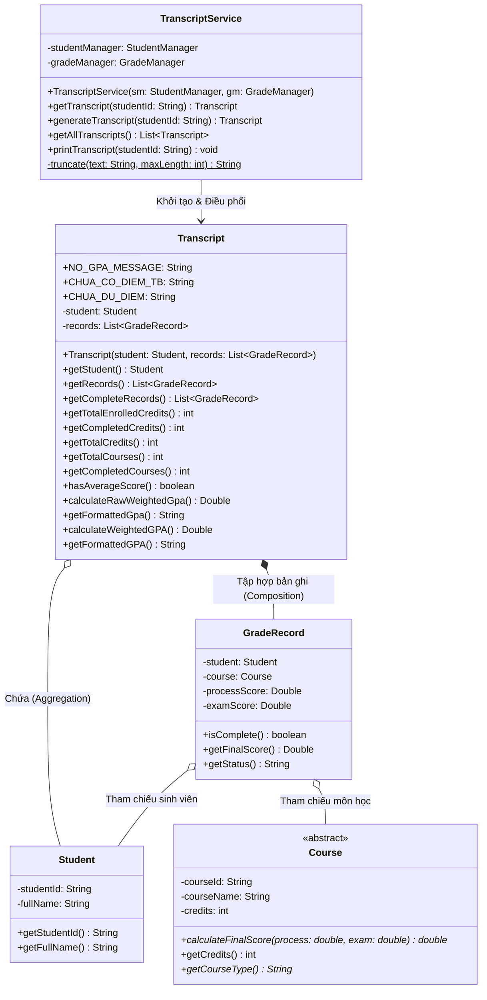

# Báo Cáo Phân Công: Người 1 — Trưởng Nhóm / Bảng Điểm
**Dự án:** Quản lý sinh viên và bảng điểm (Đề tài P05 - PRO192 FA26)  
**Nhóm:** Group 02 - Lớp SE21B  
**Thành viên phụ trách:** Người 1 — Trưởng nhóm / Bảng điểm  

---

## 1. Vai trò & Trách nhiệm của Người 1

### 1.1. Trách nhiệm quản trị & Điều phối dự án (Trưởng nhóm)
1. **Quản lý kho mã nguồn (GitHub Repository):**
   - Khởi tạo repository `FPTU-FA26-PRO192-SE21B-Group02`, cấu hình dự án NetBeans 17 chuẩn JDK 1.8 (Java 8).
   - Mời giảng viên hướng dẫn (`khoand96`) làm collaborator theo đúng quy định học phần.
   - Thiết lập cấu trúc thư mục, quy ước Git commit rõ ràng theo từng thành viên và tính năng.
2. **Chủ trì phân công và thống nhất kỹ thuật:**
   - Tổ chức họp thống nhất mô hình hướng đối tượng OOP (phương án lớp trừu tượng `Course` với `TheoryCourse` và `PracticeCourse`).
   - Thống nhất biểu diễn điểm thiếu (`Double null`), chuẩn lưu trữ file (`data/data_store.txt`), chuẩn xuất CSV (RFC 4180).
   - Quản lý tiến độ 14 ngày theo checklist 4 giai đoạn (D1–D2, D3–D7, D8–D11, D12–D14).
   - Thiết lập nhật ký minh bạch sử dụng AI (`/docs/ai_logs/AI_INTERACTION_LOG.md`).

### 1.2. Trách nhiệm kỹ thuật & Lập trình (Module Bảng điểm)
1. **Thiết kế thực thể `Transcript` (Bảng điểm):**
   - Đóng gói toàn bộ thông tin kết quả học tập của một sinh viên: đối tượng `Student` và danh sách `GradeRecord`.
   - Cung cấp các phương thức thống kê học vụ: tổng số môn đăng ký, số môn hoàn thành đủ điểm, tổng số tín chỉ đăng ký, số tín chỉ tích lũy.
2. **Thuật toán tính điểm trung bình chung tích lũy (GPA) có trọng số tín chỉ:**
   - Lọc chính xác các môn học đã đủ điểm (`isComplete() == true`). Các môn còn thiếu điểm (`null`) tuyệt đối không tham gia vào tử số và mẫu số của GPA.
   - Áp dụng công thức tính điểm trung bình từ số thô chưa làm tròn:
     $$\text{GPA}_{\text{raw}} = \frac{\sum_{i \in \text{Môn đủ điểm}} (\text{Điểm TK thô}_i \times \text{Tín chỉ}_i)}{\sum_{i \in \text{Môn đủ điểm}} \text{Tín chỉ}_i}$$
   - Quy tắc làm tròn nửa lên (HALF_UP) với đúng 2 chữ số thập phân (`Locale.US`, `String.format("%.2f", ...)`), chỉ làm tròn khi hiển thị console hoặc xuất CSV, không lấy chuỗi đã format để tính toán tiếp.
3. **Xử lý an toàn các trường hợp biên:**
   - Trả về hằng số `CHUA_CO_DIEM_TRUNG_BINH` khi sinh viên chưa có môn nào đủ điểm hoặc chưa đăng ký môn học nào. Tuyệt đối không chia cho 0, không gây ngoại lệ `ArithmeticException`, không trả về `NaN` hoặc hiển thị `0.00`.
   - Với bảng điểm có môn thiếu điểm: hiển thị rõ điểm trung bình tạm tính kèm tỷ lệ môn/tín chỉ đủ điểm trên tổng số đã ghi nhận (ví dụ: *Đủ 2/3 môn, 5/7 tín chỉ*).
4. **Xây dựng Dịch vụ Bảng điểm (`TranscriptService`):**
   - Đóng vai trò tầng nghiệp vụ (Service layer), liên kết giữa `StudentManager` và `GradeManager` để tổng hợp bảng điểm.
   - Xuất bảng điểm chi tiết dạng bảng (tabular console) căn chỉnh lề chuyên nghiệp, hỗ trợ cắt ngắn chuỗi tên môn dài tránh vỡ layout.
5. **Bảo vệ dữ liệu & Tính đóng gói (Encapsulation & Immutability):**
   - Các danh sách trả về từ `getRecords()` và `getCompleteRecords()` đều được bọc trong `Collections.unmodifiableList` để ngăn chặn việc sửa đổi dữ liệu ngoài kiểm soát.
   - Kiểm tra ràng buộc hợp lệ: sinh viên không được phép `null` trong constructor.
6. **Phụ trách kiểm thử tự động:**
   - Xây dựng bộ test tự động `Person1Test.java` kiểm thử đầy đủ các ca: **D02**, **D04**, **D06**, **D07**, và ca liên đới **D03**, đạt tỷ lệ **100% PASS** (54/54 assertions).

---

## 2. Thiết kế Hướng đối tượng & Quan hệ giữa các lớp

### Sơ đồ lớp (Class Diagram)



### Các nguyên lý OOP được áp dụng trong Module Bảng điểm:
1. **Tính đóng gói (Encapsulation) & Bảo vệ dữ liệu (Defensive Design):**
   - Mọi thuộc tính của `Transcript` và `TranscriptService` đều là `private`.
   - Constructor của `Transcript` thực hiện sao chép phòng thủ: `new ArrayList<GradeRecord>(records)` để tránh việc danh sách bị thay đổi từ bên ngoài tham chiếu.
   - Các phương thức truy vấn `getRecords()` và `getCompleteRecords()` trả về danh sách chỉ đọc (`Collections.unmodifiableList(...)`). Bất kỳ thao tác thêm/xóa phần tử nào ngoài luồng đều bị chặn lại với ngoại lệ `UnsupportedOperationException`.
2. **Tách biệt trách nhiệm (Separation of Concerns):**
   - `Transcript` là lớp mô hình nghiệp vụ (Domain Model): thuần túy lưu trữ trạng thái kết quả của một sinh viên và thực hiện các phép tính học vụ (tín chỉ, GPA, trạng thái hoàn thành).
   - `TranscriptService` là lớp dịch vụ nghiệp vụ (Service): chịu trách nhiệm truy xuất dữ liệu từ các Manager, tạo đối tượng `Transcript` và định dạng kết quả hiển thị ra console.
   - Module tính toán bảng điểm hoàn toàn không phụ thuộc vào thao tác nhập từ bàn phím (`Scanner`), cho phép chạy kiểm thử độc lập (Unit Test) và tái sử dụng linh hoạt cho module xuất CSV của Người 5.
3. **Tuân thủ quy chuẩn mã nguồn môn học:**
   - Sử dụng từ khóa tường minh `this.` khi truy cập thuộc tính và phương thức nội tại của lớp.
   - Cài đặt giao tiếp `Serializable` cho `Transcript` và `TranscriptService` đảm bảo tương thích hoàn toàn với kiến trúc hệ thống phân tán và lưu trữ đối tượng.

---

## 3. Vị trí và Cơ chế Tiếp nhận Lời gọi Đa hình (Polymorphism)

### 3.1. Vị trí xuất hiện lời gọi đa hình trong luồng Bảng điểm
Lời gọi đa hình cốt lõi của toàn bộ dự án diễn ra khi `Transcript` duyệt qua từng bản ghi học tập của sinh viên để tính điểm tổng kết và cộng dồn điểm trung bình tích lũy:

```java
// Trong Transcript.java (calculateRawWeightedGpa):
for (GradeRecord r : this.records) {
    if (r.isComplete() && r.getFinalScore() != null) {
        int credits = r.getCourse().getCredits();
        totalPoints += r.getFinalScore().doubleValue() * credits;
        totalCredits += credits;
    }
}
```

Và bên trong `GradeRecord.java (getFinalScore)`:
```java
public Double getFinalScore() {
    if (!this.isComplete()) {
        return null;
    }
    // === LỜI GỌI ĐA HÌNH CỐT LÕI (DYNAMIC METHOD DISPATCH) ===
    return this.course.calculateFinalScore(this.processScore, this.examScore);
}
```

### 3.2. Cơ chế hoạt động tại Runtime
1. **Biên dịch (Compile-time):**
   - Biến `course` trong `GradeRecord` có kiểu khai báo tĩnh là lớp trừu tượng `Course`.
   - Trình biên dịch chỉ kiểm tra xem `Course` có khai báo phương thức `calculateFinalScore(double, double)` hay không.
2. **Thực thi (Runtime):**
   - Khi JVM thực thi câu lệnh, nó kiểm tra đối tượng thực tế nằm trên Heap mà biến `course` đang trỏ tới:
     - Nếu đối tượng thực tế là một `TheoryCourse` (Môn Lý thuyết do Người 2 cài đặt), máy ảo Java tự động gọi phương thức:
       $$\text{finalScore} = 0.30 \times \text{processScore} + 0.70 \times \text{examScore}$$
     - Nếu đối tượng thực tế là một `PracticeCourse` (Môn Thực hành do Người 2 cài đặt), máy ảo Java tự động gọi phương thức:
       $$\text{finalScore} = 0.50 \times \text{processScore} + 0.50 \times \text{examScore}$$
3. **Giá trị kiến trúc (Open/Closed Principle - SOLID):**
   - Module `Transcript` và `TranscriptService` của Người 1 hoàn toàn không cần bất kỳ câu lệnh `if (course instanceof TheoryCourse)` hay `switch-case` nào.
   - Khi dự án mở rộng thêm các loại môn học mới (ví dụ: `ProjectCourse` tính 100% điểm bảo vệ, hay `OnlineCourse`), Người 1 không cần sửa đổi bất kỳ dòng code nào trong module bảng điểm.

---

## 4. Kết quả Thực tế các Ca Kiểm thử (D02, D04, D06, D07, D03)

Bộ kiểm thử tự động `Person1Test` được biên dịch và thực thi trên môi trường **JDK 1.8.0_202**. Toàn bộ **54/54 assertions (100%)** đều đạt kết quả **PASS**:

| Mã ca test | Mục tiêu kiểm thử | Dữ liệu đầu vào | Kết quả kỳ vọng | Kết quả thực tế | Trạng thái |
|:---:|---|---|---|:---:|:---:|
| **D02** | Xem trung bình tạm tính của An (dữ liệu mẫu) | An: LT101 (8, 6, 3TC), TH101 (8, 6, 2TC), LT102 (9, thiếu, 2TC) | Điểm tổng kết: LT101 = 6.60, TH101 = 7.00. Điểm TB tạm tính: $\frac{6.6 \times 3 + 7 \times 2}{5} = 6.76$. Đủ 2/3 môn, 5/7 tín chỉ. | **6.7600 (Formatted: 6.76)**<br>Đủ 2/3 môn, 5/7 TC | **PASS** |
| **D03** | Bảng điểm sinh viên chưa có kết quả (Bình) | Bình (QE210002) chưa có kết quả môn nào | 0/0 môn, 0/0 tín chỉ. `hasAverageScore() = false`. GPA trả về `null`, hiển thị `CHUA_CO_DIEM_TRUNG_BINH`. Không chia cho 0, không hiện `0.00`. | **CHUA_CO_DIEM_TRUNG_BINH**<br>0/0 môn, 0/0 TC | **PASS** |
| **D03 (Bổ sung)** | Sinh viên có môn nhưng tất cả đều thiếu điểm | Sinh viên có 2 môn nhưng cả 2 môn đều thiếu 1 thành phần điểm | Hoàn thành 0 môn, tích lũy 0 TC. GPA `null`, hiển thị `CHUA_CO_DIEM_TRUNG_BINH`. | **CHUA_CO_DIEM_TRUNG_BINH**<br>0/2 môn, 0/5 TC | **PASS** |
| **D04** | An hoàn thành LT102 với điểm quá trình bằng 0 | Đặt LT102 của An: QT = 0.0, CK = 10.0 (2 tín chỉ) | Tổng kết LT102: $0 \times 0.3 + 10 \times 0.7 = 7.00$. GPA: $\frac{47.8}{7} \approx 6.82857 \rightarrow$ làm tròn HALF_UP thành **6.83**. Đủ 3/3 môn, 7/7 tín chỉ. | **6.828571 (Formatted: 6.83)**<br>Đủ 3/3 môn, 7/7 TC | **PASS** |
| **D06** | Nhập lại cặp An–LT101 và cập nhật cuối kỳ thành 8.0 | Thêm lại cặp An–LT101; cập nhật CK LT101 = 8.0 | Không tạo dòng trùng (vẫn 3 môn). Tổng kết LT101 mới = 8.00. GPA tạm tính: $\frac{8 \times 3 + 7 \times 2}{5} = \mathbf{7.60}$. Đủ 2/3 môn, 5/7 tín chỉ. | **7.6000 (Formatted: 7.60)**<br>Không dòng trùng, đủ 2/3 môn | **PASS** |
| **D07** | Độ chính xác số học: Tính GPA từ số thô chưa làm tròn (Bình) | Bình có 2 môn LT (mỗi môn 1 TC):<br>Môn A: QT=8.01, CK=8.00<br>Môn B: QT=8.02, CK=8.00 | Tổng kết thô: A = 8.003, B = 8.006.<br>Hiển thị từng môn: 8.00 và 8.01.<br>GPA tính từ số thô: $\frac{8.003 + 8.006}{2} = 8.0045 \rightarrow$ làm tròn thành **8.00**.<br>*(Nếu tính từ số đã format 8.00 và 8.01 thì ra 8.01: SAI)*. Đủ 2/2 môn, 2/2 TC. | **8.004500 (Formatted: 8.00)**<br>Đủ 2/2 môn, 2/2 TC | **PASS** |
| **Immutability** | Bảo vệ tính bất biến danh sách bảng điểm | Gọi `add()` hoặc `clear()` trên `getRecords()` và `getCompleteRecords()` | Ném `UnsupportedOperationException`, không cho phép can thiệp danh sách ngoài luồng quản lý. | **Chặn thành công** | **PASS** |
| **Validation** | Chặn sinh viên `null` trong Constructor Transcript | Khởi tạo `new Transcript(null, records)` | Ném `IllegalArgumentException`. | **Bắt ngoại lệ thành công** | **PASS** |
| **Service Integration** | Tích hợp hiển thị bảng điểm Console qua TranscriptService | Gọi `printTranscript` cho An, Bình và mã không tồn tại | In đúng bảng dạng tabular căn lề đẹp mắt, hiển thị đầy đủ tổng số môn, số tín chỉ tích lũy và GPA. Không gây crash. | **In console hoàn tất an toàn** | **PASS** |

---

## 5. Hướng dẫn Trả lời Vấn đáp (Q&A Defense) dành cho Trưởng Nhóm

Dưới đây là các câu hỏi trọng tâm giảng viên thường vấn đáp Người 1 (Trưởng nhóm / Bảng điểm):

### Câu hỏi 1: Tại sao công thức tính GPA bắt buộc phải tính từ điểm thô chưa làm tròn mà không được lấy điểm tổng kết đã làm tròn của từng môn?
> **Trả lời:** Theo yêu cầu học vụ và đề tài P05, việc làm tròn chỉ được phép thực hiện một lần duy nhất tại bước hiển thị hoặc kết xuất báo cáo cuối cùng. Nếu lấy điểm đã làm tròn của từng môn để tính tiếp GPA, sai số làm tròn tích lũy (accumulated rounding error) sẽ làm biến dạng kết quả.  
> Minh chứng rõ nhất là ở **Ca kiểm thử D07**: Sinh viên Bình có 2 môn với điểm tổng kết thô lần lượt là `8.003` và `8.006`.
> - Khi hiển thị từng môn, chúng được làm tròn thành `8.00` và `8.01`.
> - Nếu tính từ điểm đã làm tròn: $\text{GPA} = \frac{8.00 + 8.01}{2} = 8.005 \rightarrow$ làm tròn thành `8.01` (Sai lệch).
> - Trong khi hệ thống của nhóm em tính đúng từ số thô: $\text{GPA}_{\text{raw}} = \frac{8.003 + 8.006}{2} = 8.0045 \rightarrow$ làm tròn nửa lên cho kết quả chuẩn xác là **`8.00`**.

### Câu hỏi 2: Lời gọi đa hình chính của đề bài được tiếp nhận như thế nào trong luồng bảng điểm của bạn?
> **Trả lời:** Lời gọi đa hình diễn ra trong phương thức `calculateRawWeightedGpa()` của `Transcript`, thông qua `GradeRecord.getFinalScore()` gọi đến `this.course.calculateFinalScore(processScore, examScore)`.  
> Tại thời điểm biên dịch, biến `course` chỉ có kiểu tĩnh là lớp trừu tượng `Course`. Khi chương trình chạy tại Runtime, máy ảo Java (JVM) sử dụng cơ chế Dynamic Method Dispatch để tự động phân giải và thực thi phương thức tính điểm tương ứng của `TheoryCourse` (30%/70%) hoặc `PracticeCourse` (50%/50%). Module bảng điểm hoàn toàn không sử dụng `instanceof` hay `if-else`, tuân thủ nguyên lý Open/Closed Principle (OCP).

### Câu hỏi 3: Khi sinh viên chưa có môn nào đủ điểm (hoặc chưa đăng ký môn nào), hệ thống xử lý thế nào để tránh lỗi chia cho 0 (`ArithmeticException` hoặc `NaN`)?
> **Trả lời:** Trong lớp `Transcript`, em cài đặt phương thức kiểm tra điều kiện an toàn:
> ```java
> public boolean hasAverageScore() {
>     return this.getCompletedCredits() > 0;
> }
> ```
> Trước khi thực hiện phép chia tính GPA, hàm `calculateRawWeightedGpa()` kiểm tra: nếu `hasAverageScore()` là `false` hoặc tổng tín chỉ các môn đủ điểm bằng 0, phương thức lập tức trả về `null`. Khi đó, phương thức `getFormattedGpa()` sẽ chuyển đổi thành chuỗi hằng số `CHUA_CO_DIEM_TRUNG_BINH` (minh chứng qua **Ca D03** của sinh viên Bình). Cơ chế này loại bỏ hoàn toàn nguy cơ chia cho 0 và không bao giờ hiển thị điểm 0.00 gây hiểu lầm học vụ.

### Câu hỏi 4: Tại sao trong `Transcript`, các danh sách trả về lại sử dụng `Collections.unmodifiableList`?
> **Trả lời:** Đây là kỹ thuật thiết kế bảo vệ dữ liệu (Defensive Design) nhằm đảm bảo tính đóng gói (Encapsulation) và tính toàn vẹn (Data Integrity). Bảng điểm `Transcript` là kết quả tổng hợp chỉ đọc (Read-only view). Nếu trả về trực tiếp danh sách `records`, mã nguồn bên ngoài (ví dụ như tầng UI hoặc các service khác) có thể vô tình gọi `.clear()` hoặc `.add()` làm thay đổi dữ liệu bên trong `Transcript` mà không qua kiểm soát của `GradeManager`. Việc bọc danh sách trong `Collections.unmodifiableList` đảm bảo danh sách không thể bị chỉnh sửa sau khi khởi tạo.

### Câu hỏi 5: Với vai trò trưởng nhóm, bạn đã tổ chức điều phối và quản trị tiến độ dự án 14 ngày như thế nào?
> **Trả lời:** Em đã chủ trì thống nhất kiến trúc ngay từ giai đoạn D1–D2:
> 1. Chốt mô hình OOP: thống nhất chữ ký phương thức tính điểm đa hình của Người 2, cấu trúc `GradeRecord` của Người 3, cách thức biểu diễn điểm thiếu (`Double null`) của Người 4, và định dạng lưu file của Người 5.
> 2. Phân tách ranh giới trách nhiệm rõ ràng (Separation of Concerns): Từng thành viên làm việc độc lập trên các package riêng biệt (`models`, `services`, `storage`, `ui`), không ai phụ thuộc vào Console I/O của người khác.
> 3. Quản trị qua checklist 11 việc/người và bộ test tự động riêng (`Person1Test`, `Person2Test`, `Person5Test`), đảm bảo việc ghép nối (integration) ở giai đoạn D7 và D11 diễn ra thuận lợi, không xảy ra xung đột mã nguồn.
