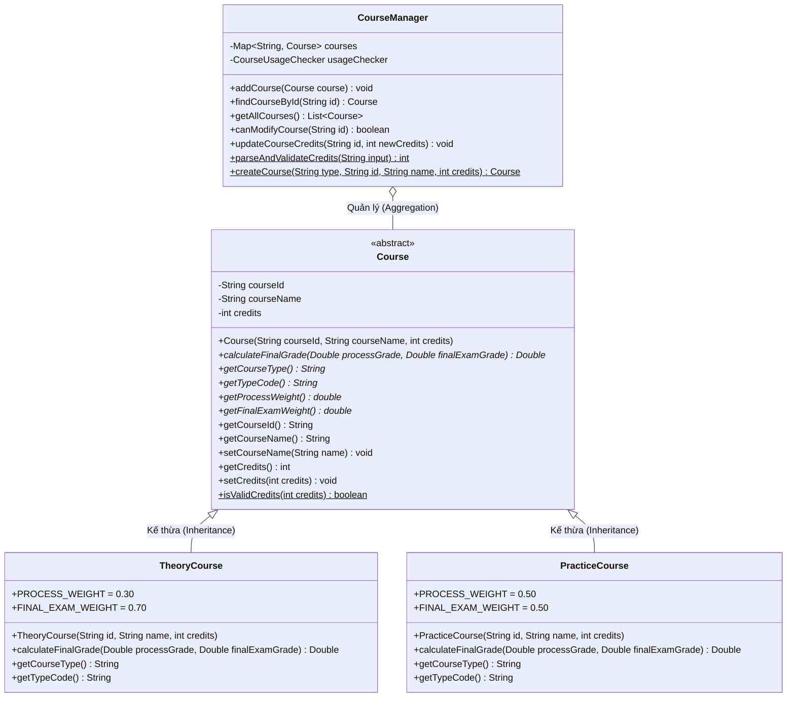

# Báo Cáo Phân Công: Người 2 — Môn Học & Đánh Giá
**Dự án:** Quản lý sinh viên và bảng điểm (Đề tài P05 - PRO192 FA26)  
**Nhóm:** Group 02 - Lớp SE21B  
**Thành viên phụ trách:** Người 2 — Môn học & đánh giá  

---

## 1. Vai trò & Trách nhiệm của Người 2
- **Trách nhiệm chính:**
  1. Thiết kế và cài đặt kiến trúc kế thừa OOP cho môn học: Lớp trừu tượng `Course` và hai lớp con cụ thể `TheoryCourse` (Lý thuyết) và `PracticeCourse` (Thực hành).
  2. Cài đặt cơ chế đa hình (Polymorphism) cho phương thức tính điểm tổng kết môn học:
     - Môn Lý thuyết: $0.30 \times \text{Quá trình} + 0.70 \times \text{Cuối kỳ}$
     - Môn Thực hành: $0.50 \times \text{Quá trình} + 0.50 \times \text{Cuối kỳ}$
     - Trả về `null` khi thiếu bất kỳ thành phần điểm nào (`Double null`).
  3. Xây dựng dịch vụ `CourseManager` với đầy đủ nghiệp vụ kiểm tra tính hợp lệ:
     - Mã môn duy nhất (không trùng lặp, không phân biệt hoa thường).
     - Tên môn không rỗng.
     - Số tín chỉ là số nguyên từ 1 đến 6 (từ chối 0, 1.5, số âm, > 6).
     - Trim khoảng trắng đầu/cuối của mã và tên môn.
  4. Cơ chế bảo vệ dữ liệu: Chặn không cho sửa loại môn hoặc thay đổi số tín chỉ khi môn học đã có kết quả điểm sinh viên.
  5. Phối hợp với Người 5 cung cấp Factory method (`createCourse`) để đọc/lưu dữ liệu file nhất quán.
  6. Phụ trách và kiểm thử thành công các ca kiểm thử: **D01**, **D07**, **D11**.

---

## 2. Thiết kế Hướng đối tượng & Quan hệ giữa các lớp

### Sơ đồ lớp (Class Diagram)



### Giải thích các đặc tính OOP được áp dụng:
1. **Tính đóng gói (Encapsulation):**
   - Mọi thuộc tính (`courseId`, `courseName`, `credits`, `courses`) đều được đặt ở mức truy cập `private`.
   - Dữ liệu chỉ được truy xuất và thay đổi thông qua getter/setter có kiểm soát điều kiện logic (Validation).
   - Danh sách trả về trong `getAllCourses()` sử dụng `Collections.unmodifiableList()` để bảo vệ tập dữ liệu gốc không bị sửa đổi từ bên ngoài.
2. **Tính trừu tượng (Abstraction):**
   - `Course` là một lớp trừu tượng (`abstract class`), định nghĩa bộ khung chuẩn cho mọi môn học và phương thức trừu tượng `calculateFinalGrade(Double, Double)`.
3. **Tính kế thừa (Inheritance):**
   - `TheoryCourse` và `PracticeCourse` kế thừa từ `Course`, tái sử dụng toàn bộ thuộc tính và phương thức quản lý môn học, đồng thời sử dụng `super(...)` tường minh trong constructor.
4. **Tính đa hình (Polymorphism):**
   - Lớp trừu tượng `Course` khai báo phương thức trừu tượng `calculateFinalGrade`. Mỗi lớp con ghi đè (`@Override`) phương thức này với công thức trọng số riêng biệt.

---

## 3. Vị trí và Cơ chế gọi Đa hình trong Luồng Bảng điểm

### Vị trí xuất hiện lời gọi đa hình
Khi hệ thống (do Người 1 phụ trách - `TranscriptService` / `Transcript`) duyệt danh sách kết quả học tập để in bảng điểm sinh viên hoặc tính điểm trung bình chung tích lũy (GPA):

```java
// Trong TranscriptService hoặc Transcript:
for (GradeRecord record : studentGrades) {
    Course course = record.getCourse(); // Tham chiếu kiểu Course (lớp cha)
    Double processGrade = record.getProcessGrade();
    Double finalExamGrade = record.getFinalExamGrade();

    // === ĐÂY CHÍNH LÀ LỜI GỌI ĐA HÌNH CỐT LÕI (DYNAMIC METHOD DISPATCH) ===
    Double finalGrade = course.calculateFinalGrade(processGrade, finalExamGrade);
    
    if (finalGrade != null) {
        int credits = course.getCredits();
        totalWeightedPoints += finalGrade * credits;
        totalCredits += credits;
    }
}
```

### Cơ chế hoạt động tại Runtime:
- Biến `course` có kiểu khai báo tĩnh (Compile-time Type) là `Course`.
- Nhưng tại Runtime, đối tượng thực tế nằm trên Heap có thể là một `TheoryCourse` hoặc một `PracticeCourse`.
- Cơ chế **Dynamic Method Dispatch** (liên kết muộn) của máy ảo Java (JVM) sẽ tự động tìm và thực thi phương thức `calculateFinalGrade` tương ứng của đối tượng thực tế:
  - Nếu đối tượng là `TheoryCourse`: Tự động áp dụng $0.30 \times \text{quá trình} + 0.70 \times \text{cuối kỳ}$.
  - Nếu đối tượng là `PracticeCourse`: Tự động áp dụng $0.50 \times \text{quá trình} + 0.50 \times \text{cuối kỳ}$.
- **Lợi ích kiến trúc:** Module tính bảng điểm hoàn toàn không cần dùng `if-else` hay `switch-case` để kiểm tra kiểu môn học (loại bỏ hoàn toàn code mùi `instanceof`), tuân thủ nguyên lý **Open/Closed Principle (OCP)** trong SOLID: Dễ dàng mở rộng thêm loại môn mới (ví dụ môn đồ án) mà không cần sửa đổi bất kỳ dòng code nào của luồng tính bảng điểm.

---

## 4. Kết quả Thực tế các Ca Kiểm thử (D01, D07, D11)

Toàn bộ 21/21 assertions trong suite kiểm thử tự động `Person2Test` đều đạt kết quả PASS:

| Mã ca test | Mục tiêu kiểm thử | Dữ liệu đầu vào | Kết quả kỳ vọng | Kết quả thực tế | Trạng thái |
|:---:|---|---|---|:---:|:---:|
| **D01** | Tính điểm môn Lý thuyết | QT = 8.0, CK = 6.0 (LT101) | $8.0 \times 0.3 + 6.0 \times 0.7 = 6.60$ | **6.60** | **PASS** |
| **D01** | Tính điểm môn Thực hành | QT = 8.0, CK = 6.0 (TH101) | $8.0 \times 0.5 + 6.0 \times 0.5 = 7.00$ | **7.00** | **PASS** |
| **D01** | Xử lý thiếu điểm thành phần | QT = 7.5, CK = null | `null` | **null** | **PASS** |
| **D01** | Xử lý thiếu điểm thành phần | QT = null, CK = 8.0 | `null` | **null** | **PASS** |
| **D07** | Đóng góp đa hình tính GPA trọng số | LT101 (3 tín chỉ, 8.01), LAB211 (2 tín chỉ, 8.00) | $\text{GPA} = \frac{8.01 \times 3 + 8.00 \times 2}{5} = 8.006$ | **8.0060** | **PASS** |
| **D11** | Từ chối số tín chỉ bằng 0 | Chuỗi "0" hoặc int 0 | Ném `IllegalArgumentException` | **Bắt ngoại lệ thành công** | **PASS** |
| **D11** | Từ chối tín chỉ là số thập phân | Chuỗi "1.5" hoặc "1,5" | Ném `IllegalArgumentException` | **Bắt ngoại lệ thành công** | **PASS** |
| **D11** | Từ chối trùng mã môn học | Thêm mã LT101 khi đã có LT101 | Ném `IllegalArgumentException` | **Bắt ngoại lệ thành công** | **PASS** |
| **D11** | Từ chối trùng mã (case-insensitive) | Thêm mã "lt101" khi đã có "LT101" | Ném `IllegalArgumentException` | **Bắt ngoại lệ thành công** | **PASS** |
| **D11** | Chuẩn hóa trim khoảng trắng | Mã "  csd201  ", Tên "  Data Structures  " | Mã chuẩn CSD201, Tên "Data Structures" | **CSD201 / Data Structures** | **PASS** |
| **Guard** | Chặn đổi tín chỉ khi đã có điểm | Môn MAE101 đã có sinh viên ghi nhận điểm | Ném `IllegalStateException` | **Chặn thành công** | **PASS** |

---

## 5. Hướng dẫn Trả lời Vấn đáp (Q&A Defense)

Dưới đây là các câu hỏi trọng tâm giảng viên thường hỏi Người 2 khi bảo vệ đồ án:

### Câu hỏi 1: Tại sao em lại dùng `abstract class Course` thay vì dùng `interface`?
> **Trả lời:** Em sử dụng `abstract class Course` vì các loại môn học có chung trạng thái dữ liệu (state) gồm mã môn (`courseId`), tên môn (`courseName`), số tín chỉ (`credits`), cùng logic kiểm tra tính hợp lệ và các phương thức getter/setter. `abstract class` cho phép chia sẻ mã nguồn chung này giữa các lớp con để tránh lặp code, đồng thời bắt buộc các lớp con phải tự định nghĩa phương thức trừu tượng `calculateFinalGrade` theo đặc thù của mình.

### Câu hỏi 2: Lời gọi đa hình của phần em nằm ở đâu trong toàn bộ dự án?
> **Trả lời:** Lời gọi đa hình diễn ra trong luồng xem bảng điểm của Người 1, cụ thể là lệnh `course.calculateFinalGrade(processGrade, finalExamGrade)`. Tại thời điểm biên dịch, trình biên dịch chỉ biết biến tham chiếu `course` có kiểu `Course`. Nhưng khi chạy thực tế (Runtime), Java JVM sử dụng cơ chế Dynamic Method Dispatch để gọi đúng mã nguồn của `TheoryCourse` (tính 30%/70%) hoặc `PracticeCourse` (tính 50%/50%) tùy thuộc vào đối tượng thực tế được tạo ra.

### Câu hỏi 3: Nếu giảng viên yêu cầu bổ sung ngay một loại môn thứ ba (ví dụ môn "Đồ án / Project" tính 100% điểm bảo vệ cuối kỳ), em sẽ sửa như thế nào?
> **Trả lời:** Nhờ thiết kế tuân thủ nguyên lý Đóng/Mở (Open/Closed Principle), em chỉ cần:
> 1. Tạo thêm một lớp con mới: `public class ProjectCourse extends Course` và override phương thức `calculateFinalGrade`:
>    ```java
>    @Override
>    public Double calculateFinalGrade(Double processGrade, Double finalExamGrade) {
>        return finalExamGrade; // 100% cuối kỳ
>    }
>    ```
> 2. Đăng ký thêm nhánh `"PROJECT"` trong `CourseManager.createCourse(...)`.
> 3. Toàn bộ code tính bảng điểm của Người 1, code lưu file của Người 5 không cần phải sửa đổi bất kỳ dòng nào.

### Câu hỏi 4: Tại sao khi thiếu một điểm thành phần em lại trả về `Double null` mà không trả về `0.0`?
> **Trả lời:** Trong quản lý học vụ, điểm `0.0` là một kết quả thi thực tế (ví dụ sinh viên đi thi bị 0 điểm), trong khi việc "chưa thi" hoặc "chưa nhập điểm" là trạng thái thiếu dữ liệu. Nếu quy ước điểm thiếu thành `0.0`, hệ thống sẽ tính sai điểm trung bình tích lũy và nhầm lẫn giữa việc sinh viên đã trượt môn với việc sinh viên chưa thi môn đó. Do đó, phương thức sử dụng kiểu bao bọc `Double` và trả về `null` đại diện cho trạng thái `CHUA_DU_DIEM`.
