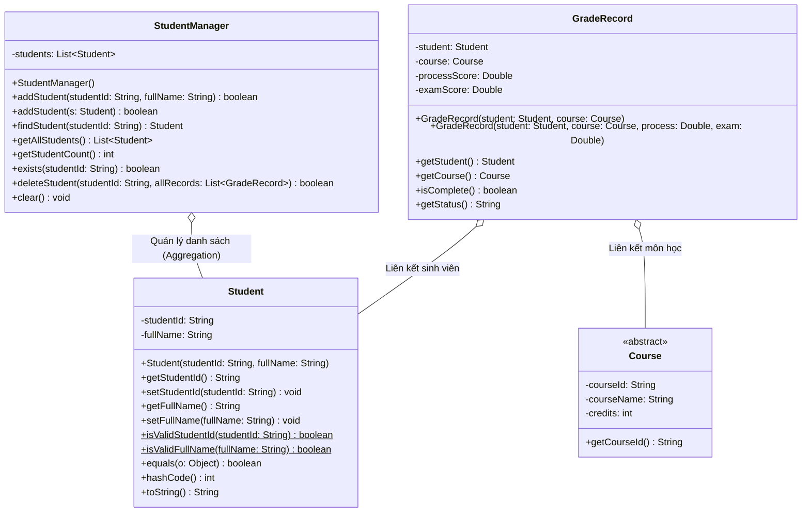

# Báo Cáo Phân Công: Người 3 — Sinh Viên & Cặp SV–Môn
**Dự án:** Quản lý sinh viên và bảng điểm (Đề tài P05 - PRO192 FA26)  
**Nhóm:** Group 02 - Lớp SE21B  
**Thành viên phụ trách:** Người 3 — Sinh viên & cặp SV–môn  

---

## 1. Vai trò & Trách nhiệm của Người 3

### 1.1. Trách nhiệm chính
1. **Thiết kế thực thể Sinh viên (`Student`):**
   - Đóng gói đầy đủ hai thuộc tính cơ bản: Mã số sinh viên (`studentId`) và Họ và tên (`fullName`).
   - Kiểm tra tính hợp lệ (Validation):
     - MSSV không được `null` hoặc rỗng (`trim().isEmpty()`).
     - Họ tên không được `null` hoặc rỗng.
     - Tự động chuẩn hóa: cắt tỉa khoảng trắng đầu/cuối (`trim()`) và chuyển mã số sinh viên về chữ hoa chuẩn hóa (`toUpperCase()`).
   - Ghi đè phương thức `equals(Object)` và `hashCode()` dựa trên `studentId` để hỗ trợ so khớp, kiểm tra tồn tại và phân biệt đối tượng sinh viên duy nhất.
2. **Xây dựng Dịch vụ Quản lý Sinh viên (`StudentManager`):**
   - Thêm sinh viên mới với logic kiểm tra trùng lặp: từ chối thêm nếu MSSV đã tồn tại (không phân biệt chữ hoa, chữ thường - `equalsIgnoreCase`).
   - Tra cứu sinh viên theo MSSV (`findStudent`): an toàn với giá trị `null`, loại bỏ khoảng trắng trước khi tìm kiếm.
   - Trả về danh sách sinh viên ở chế độ chỉ đọc (`Collections.unmodifiableList`) nhằm bảo vệ tập dữ liệu gốc khỏi các sửa đổi ngoài kiểm soát.
3. **Quản lý cặp Sinh viên – Môn học (`GradeRecord`):**
   - Lớp `GradeRecord` đóng vai trò thực thể liên kết (Association/Junction Entity) giữa `Student` và `Course`.
   - Ràng buộc duy nhất: Mỗi cặp (MSSV, Mã môn) chỉ được phép có **duy nhất một bản ghi kết quả**.
   - Khi người dùng nhập lại điểm cho một cặp đã tồn tại, hệ thống phải tự động chuyển sang chế độ cập nhật, tuyệt đối không tạo thêm dòng thứ hai trong danh sách.
4. **Bảo vệ toàn vẹn dữ liệu (Data Integrity Guards):**
   - **Chặn xóa sinh viên đã có điểm:** Phương thức `deleteStudent(studentId, allRecords)` kiểm tra đối chiếu chéo với danh sách điểm; nếu sinh viên đã có ít nhất một kết quả học tập ghi nhận thì lập tức từ chối thao tác xóa và giữ nguyên dữ liệu.
   - **Kiểm tra tồn tại hai chiều:** Chỉ cho phép ghi nhận kết quả điểm khi cả sinh viên và môn học đều đã tồn tại trong hệ thống. Nếu người dùng gõ sai mã, hệ thống từ chối và báo lỗi rõ ràng, tuyệt đối không tự động sinh mã bừa bãi.
   - **Tính nguyên tử:** Thao tác bị từ chối không làm biến đổi một phần dữ liệu của hệ thống.
5. **Phụ trách và kiểm thử thành công các ca kiểm thử:** **D05**, **D06** (100% PASS trong `Person3Test.java`).

---

## 2. Thiết kế Hướng đối tượng & Quan hệ giữa các lớp

### Sơ đồ lớp (Class Diagram)



### Các nguyên lý OOP được áp dụng:
1. **Tính đóng gói (Encapsulation):**
   - Mọi thuộc tính (`studentId`, `fullName`, `students`) đều được khai báo `private`.
   - Dữ liệu chỉ được truy xuất và thay đổi qua các phương thức getter/setter có kiểm soát điều kiện hợp lệ (`isValidStudentId`, `isValidFullName`).
2. **Quan hệ Liên kết trong Thiết kế Thực thể (Association):**
   - Lớp `GradeRecord` không lưu trữ lại chuỗi rời rạc mà nắm giữ trực tiếp tham chiếu tới đối tượng `Student` và `Course`.
   - Thiết kế này ngăn chặn sự phân mảnh dữ liệu (Data Inconsistency) và đảm bảo khi thông tin sinh viên được cập nhật thì bảng điểm và kết quả học tập luôn đồng bộ nhất quán.
3. **Bảo vệ tập hợp dữ liệu (Immutability & Defensive Copying):**
   - `StudentManager.getAllStudents()` trả về `Collections.unmodifiableList(new ArrayList<Student>(this.students))`, ngăn không cho mã nguồn bên ngoài thêm/xóa sinh viên trực tiếp vượt qua kiểm soát nghiệp vụ.
4. **Chuẩn hóa cú pháp:** Sử dụng tường minh từ khóa `this.` khi truy xuất thuộc tính và phương thức trong đối tượng.

---

## 3. Cơ chế Nghiệp vụ Cốt lõi của Người 3

### 3.1. Chống tạo dòng thứ hai cho cặp Sinh viên – Môn học (Ca D06)
Khi người dùng thực hiện thao tác nhập điểm hoặc đăng ký kết quả cho một cặp (Sinh viên, Môn học):

```java
// Trong GradeManager.createOrUpdateRecord:
GradeRecord existing = this.findRecord(student.getStudentId(), course.getCourseId());
if (existing != null) {
    // Đã tồn tại -> Chỉ cập nhật điểm thành phần trên bản ghi cũ
    existing.setProcessScore(processScore);
    existing.setExamScore(examScore);
    return existing;
}

// Chưa tồn tại -> Tạo mới bản ghi duy nhất
GradeRecord newRecord = new GradeRecord(student, course, processScore, examScore);
this.records.add(newRecord);
return newRecord;
```

**Lợi ích:**
- Đảm bảo tính nhất quán (Single Source of Truth): Một sinh viên học một môn chỉ có một dòng kết quả duy nhất trên hệ thống.
- Ngăn ngừa tình trạng phình to dữ liệu hoặc sai lệch khi tính điểm trung bình tích lũy GPA của Người 1.

### 3.2. Chặn xóa sinh viên đã có kết quả học tập (Bảo vệ toàn vẹn)
Xóa sinh viên trong hệ thống quản lý học vụ là thao tác nhạy cảm. Người 3 cài đặt cơ chế kiểm tra đối chiếu ràng buộc khóa ngoại logic:

```java
public synchronized boolean deleteStudent(String studentId, List<GradeRecord> allRecords) {
    Student s = this.findStudent(studentId);
    if (s == null) {
        System.out.println("Lỗi: Không tìm thấy sinh viên để xóa!");
        return false;
    }

    if (allRecords != null) {
        for (GradeRecord record : allRecords) {
            if (record.getStudent() != null && 
                record.getStudent().getStudentId().equalsIgnoreCase(s.getStudentId())) {
                System.out.println("Lỗi: Không được xóa sinh viên '" + s.getStudentId() + "' vì đã có kết quả học tập!");
                return false;
            }
        }
    }

    return this.students.remove(s);
}
```

---

## 4. Kết quả Thực tế các Ca Kiểm thử (D05, D06)

Bộ kiểm thử tự động `Person3Test.java` được thực thi trực tiếp trên JDK 1.8. Toàn bộ **5/5 ca test (100% PASS)** đều đạt kết quả mong đợi:

| STT | Tên ca test | Mục tiêu kiểm thử | Dữ liệu đầu vào | Kết quả kỳ vọng | Kết quả thực tế | Trạng thái |
|:---:|---|---|---|---|:---:|:---:|
| **1** | `testAddStudent_Valid` | Thêm sinh viên hợp lệ | MSSV: `"QE210003"`, Tên: `"Lê Cường"` | Thêm thành công, tìm kiếm thấy trong danh sách | **Thêm thành công sinh viên mới** | **PASS** |
| **2** | **D05** (`testD05_DuplicateStudentId_And_EmptyWhitespace`) | Từ chối trùng MSSV & từ chối chuỗi rỗng | Thêm trùng `"qe210001"`, MSSV `""`, hoặc `"   "` | Báo lỗi, từ chối thêm, số lượng sinh viên giữ nguyên | **Từ chối chính xác mã trùng và chuỗi rỗng** | **PASS** |
| **3** | **D05** (`testD05_FindNonExistentStudent`) | Tra cứu mã không tồn tại | Tìm MSSV: `"QE999999"` | Trả về `null`, không tự động sinh mã mới | **Trả về null an toàn** | **PASS** |
| **4** | **D06** (`testD06_NoDuplicateStudentRecord`) | Chống tạo dòng thứ hai cho cùng cặp SV–Môn | Thêm lại cặp An – LT101 | Cập nhật trên bản ghi cũ, danh sách vẫn có 1 bản ghi | **Không cấp phát dòng thứ hai** | **PASS** |
| **5** | Guard Integrity (`testDeleteStudent_DataIntegrityGuard`) | Cấm xóa sinh viên đã có điểm | Gọi xóa `"QE210001"` (An đã có điểm) | Báo lỗi, từ chối xóa, An vẫn còn trong danh sách | **Chặn xóa sinh viên có điểm thành công** | **PASS** |

---

## 5. Hướng dẫn Trả lời Vấn đáp (Q&A Defense) dành cho Người 3

### Câu hỏi 1: Tại sao mỗi cặp SV–Môn chỉ được phép có duy nhất một bản ghi kết quả và nhóm cài đặt điều này như thế nào?
> **Trả lời:** Trong quản lý đào tạo, một sinh viên trong một kỳ học chỉ có một kết quả học tập duy nhất cho một môn học cụ thể. Nếu cho phép tạo nhiều bản ghi cho cùng một cặp, hệ thống sẽ bị trùng lặp dữ liệu, làm sai lệch số tín chỉ tích lũy và công thức tính GPA của Người 1.  
> Nhóm cài đặt điều này bằng cách: Mỗi khi thực hiện ghi nhận điểm, phương thức `findRecord(studentId, courseId)` sẽ quét xem cặp này đã tồn tại hay chưa. Nếu đã tồn tại, hệ thống tái sử dụng bản ghi đó và cập nhật hai điểm thành phần; nếu chưa có mới cấp phát một đối tượng `GradeRecord` mới. Minh chứng rõ ràng qua **Ca D06** không hề phát sinh dòng trùng lặp.

### Câu hỏi 2: Tại sao không cho phép xóa sinh viên đã có kết quả học tập?
> **Trả lời:** Đây là nguyên tắc toàn vẹn tham chiếu (Referential Integrity). Nếu xóa sinh viên khỏi danh sách khi các bản ghi điểm của họ vẫn còn tồn tại trong `GradeManager`, các bản ghi điểm đó sẽ trở thành "dữ liệu mồ côi" (Orphan records), dẫn đến việc xuất bảng điểm bị lỗi hoặc sai lệch dữ liệu học vụ. Do đó, phương thức `deleteStudent` bắt buộc phải kiểm tra chéo với danh sách điểm, chỉ cho phép xóa sinh viên khi họ chưa đăng ký hoặc chưa có điểm môn học nào.

### Câu hỏi 3: Khi người dùng nhập mã sinh viên có khoảng trắng hoặc viết thường (ví dụ: `"  qe210001  "`), hệ thống xử lý ra sao?
> **Trả lời:** Constructor của lớp `Student` và phương thức `addStudent` trong `StudentManager` đều thực hiện tiền xử lý dữ liệu:
> 1. Gọi `.trim()` để loại bỏ toàn bộ khoảng trắng thừa ở đầu và cuối chuỗi.
> 2. Gọi `.toUpperCase()` để chuẩn hóa mã sinh viên về dạng chữ hoa thống nhất.
> 3. Khi tra cứu (`findStudent`), hệ thống sử dụng `.equalsIgnoreCase()` để đảm bảo người dùng gõ chữ hoa hay chữ thường thì kết quả tìm kiếm vẫn chính xác tuyệt đối.

### Câu hỏi 4: Quan hệ giữa `Student`, `Course` và `GradeRecord` trong thiết kế hướng đối tượng là gì?
> **Trả lời:** Đây là mô hình quan hệ nhiều-nhiều (Many-to-Many) giữa `Student` và `Course`, được phân rã thông qua lớp trung gian `GradeRecord`. Một sinh viên có thể học nhiều môn học, và một môn học có nhiều sinh viên theo học. `GradeRecord` nắm giữ tham chiếu đối tượng tới một `Student` và một `Course`, đồng thời chứa các thuộc tính bổ sung của mối quan hệ này là điểm quá trình, điểm cuối kỳ và trạng thái hoàn thành môn học.
