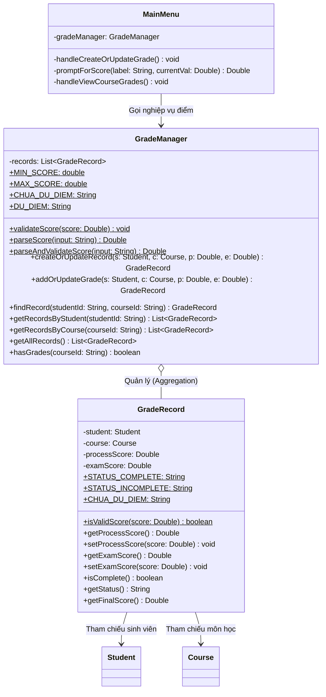

# Báo Cáo Phân Công: Người 4 — Nhập & Cập Nhật Điểm
**Dự án:** Quản lý sinh viên và bảng điểm (Đề tài P05 - PRO192 FA26)  
**Nhóm:** Group 02 - Lớp SE21B  
**Thành viên phụ trách:** Người 4 — Nhập & cập nhật điểm  

---

## 1. Vai trò & Trách nhiệm của Người 4
- **Trách nhiệm chính:**
  1. **Quản lý điểm thành phần và kết quả học tập (`GradeManager`):**
     - Nhập và cập nhật hai điểm thành phần: **Điểm quá trình** và **Điểm cuối kỳ** cho từng cặp (Sinh viên, Môn học).
     - Đảm bảo mỗi cặp SV–Môn chỉ có **duy nhất một bản ghi kết quả**, không tạo dòng trùng lặp khi cập nhật điểm nhiều lần.
  2. **Xử lý trạng thái điểm thiếu và phân biệt với điểm 0:**
     - Điểm thiếu được biểu diễn bằng `Double null`.
     - Điểm `0.0` là điểm số hợp lệ và **khác hoàn toàn** với điểm thiếu.
     - Sử dụng hằng số `CHUA_DU_DIEM = "CHUA_DU_DIEM"` cho trạng thái khi sinh viên thiếu một trong hai điểm thành phần.
  3. **Kiểm tra miền điểm chặt chẽ $[0.0; 10.0]$ tách biệt khỏi giao diện bàn phím:**
     - Cài đặt các hàm kiểm tra độc lập (`validateScore`, `parseScore`) để có thể kiểm thử đơn vị trực tiếp không qua Console I/O.
     - Từ chối nghiêm ngặt các giá trị sai phạm: số âm ($< 0.0$), số lớn hơn 10 ($> 10.0$), `Double.NaN`, vô cực (`POSITIVE_INFINITY`, `NEGATIVE_INFINITY`), chuỗi sai định dạng (`"abc"`, `"NaN"`, `"Infinity"`).
     - Ném ngoại lệ `IllegalArgumentException` với thông báo lỗi rõ ràng, có ý nghĩa học vụ.
  4. **Đảm bảo tính nguyên tử trước khi gán (Atomic Check-Before-Assign):**
     - Kiểm tra toàn bộ điều kiện hợp lệ của cả hai điểm **TRƯỚC** khi gán vào đối tượng. Nếu một điểm bị sai thì không điểm nào bị thay đổi dở dang trong bản ghi cũ.
  5. **Xây dựng luồng tương tác nhập/cập nhật điểm trong `MainMenu`:**
     - Cung cấp **3 thao tác rõ ràng** cho từng điểm thành phần:
       1. Giữ điểm cũ (nhập `'K'` hoặc `'k'`)
       2. Đặt lại thành thiếu (nhập `'EMPTY'`, `'NULL'`, hoặc `'-'`)
       3. Nhập điểm mới (giá trị số thực trong đoạn $[0.0; 10.0]$)
     - Tuyệt đối **không âm thầm đổi ô trống thành 0**.
     - Màn hình xem kết quả môn học hiển thị rõ ràng từng cột, hiển thị `CHUA_DU_DIEM` khi chưa đủ điểm và trạng thái `"ĐỦ ĐIỂM"` / `"CHƯA ĐỦ ĐIỂM"`.
  6. **Phụ trách và kiểm thử thành công các ca kiểm thử:** **D03**, **D04**, **D05**, **D10** (đạt 100% PASS).

---

## 2. Thiết kế Hướng đối tượng & Kiến trúc Lớp

### Sơ đồ lớp (Class Diagram)



### Giải thích các đặc tính OOP tuân thủ chuẩn PRO192:
1. **Tính đóng gói (Encapsulation):**
   - Danh sách bản ghi `records` trong `GradeManager` và các thuộc tính điểm `processScore`, `examScore` trong `GradeRecord` đều ở mức truy cập `private`.
   - Danh sách trả về trong `getAllRecords()`, `getRecordsByStudent()`, `getRecordsByCourse()` được bọc bằng `Collections.unmodifiableList(...)` để bảo vệ dữ liệu nội bộ không bị chỉnh sửa từ bên ngoài.
   - Viết tường minh `this.` cho toàn bộ các truy cập thuộc tính và phương thức nội bộ trong lớp.
2. **Tính trừu tượng & Tách biệt mối quan tâm (Separation of Concerns):**
   - Logic kiểm tra miền điểm (`validateScore`) và phân tích chuỗi (`parseScore`) được viết thành các phương thức tĩnh (`static`) độc lập trong `GradeManager`, hoàn toàn không phụ thuộc vào `Scanner` hay luồng Console I/O.
   - Nhờ đó, lớp kiểm thử `Person4Test` có thể gọi kiểm thử trực tiếp các trường hợp biên của miền điểm mà không cần giả lập bàn phím.
3. **Tính toàn vẹn dữ liệu (Data Integrity):**
   - Lớp `GradeManager` thực thi giao diện `Serializable` để đồng bộ hoàn toàn với kiến trúc lưu file của Người 5.

---

## 3. Cơ chế Kỹ thuật Cốt lõi & Phân biệt Nghiệp vụ

### A. Phân biệt Điểm 0 (`0.0`) và Điểm thiếu (`null`)
Trong quản lý học vụ tại FPT University, đây là hai trạng thái hoàn toàn khác biệt:
- **Điểm thiếu (`null`):** Sinh viên chưa có kết quả (chưa thi, hoãn thi, hoặc điểm chưa được công bố). Môn học ở trạng thái `CHUA_DU_DIEM`, **không có điểm tổng kết** và môn học này **không được tính vào điểm trung bình tích lũy (GPA)**.
- **Điểm 0 (`0.0`):** Sinh viên đã tham gia thi nhưng đạt kết quả 0 điểm. Đây là điểm số hợp lệ, được tính vào điểm tổng kết và kéo điểm trung bình tích lũy (GPA) xuống.

**Cài đặt kỹ thuật trong Java:**
- Sử dụng đối tượng bao bọc `Double` (Wrapper class) thay vì kiểu nguyên thủy `double`. Kiểu `double` nguyên thủy bắt buộc phải có giá trị số (thường mặc định là `0.0`), gây nhầm lẫn nghiêm trọng giữa điểm 0 và điểm thiếu.
- Khi người dùng để trống hoặc nhập chuỗi `"EMPTY"`, `"-"`, `"null"`: hàm `parseScore` trả về `null`.
- Khi người dùng nhập `"0"` hoặc `"0.0"`: hàm `parseScore` trả về đối tượng `Double.valueOf(0.0)`.

```java
// Trong GradeManager.java:
public static Double parseScore(String input) {
    if (input == null) return null;
    String clean = input.trim();
    if (clean.isEmpty() || "-".equals(clean) || "EMPTY".equalsIgnoreCase(clean) || "NULL".equalsIgnoreCase(clean)) {
        return null; // Điểm thiếu
    }
    // Parse điểm số thực sự (bao gồm số 0.0)
    clean = clean.replace(',', '.');
    double val = Double.parseDouble(clean);
    validateScore(val);
    return val;
}
```

### B. Kiểm tra Miền điểm $[0.0; 10.0]$ và Chống Lỗi Số thực Đặc biệt
Trong Java, các phép toán số thực có thể sinh ra hai giá trị đặc biệt là `NaN` (Not a Number) và `Infinity` (Vô cực). Nếu không kiểm tra tường minh, các giá trị này có thể lọt vào hệ thống và phá vỡ thuật toán tính GPA:

```java
public static void validateScore(Double score) {
    if (score == null) {
        return; // Hợp lệ (đại diện cho điểm thiếu)
    }
    if (score.isNaN() || score.isInfinite()) {
        throw new IllegalArgumentException("Điểm số không được là NaN hoặc vô cực.");
    }
    if (score < MIN_SCORE || score > MAX_SCORE) {
        throw new IllegalArgumentException(String.format(Locale.US,
                "Điểm số phải nằm trong khoảng [%.1f, %.1f] (giá trị nhập: %s).",
                MIN_SCORE, MAX_SCORE, score));
    }
}
```

### C. Tính Nguyên tử trước khi gán (Atomic Check-Before-Assign)
Yêu cầu đề bài quy định: *"Kiểm tra tất cả điều kiện TRƯỚC khi gán: nếu một điểm sai thì không điểm nào bị đổi."*  
Nếu kiểm tra điểm quá trình rồi gán ngay, sau đó điểm cuối kỳ bị lỗi ném ngoại lệ thì bản ghi sẽ rơi vào trạng thái "nửa cũ nửa mới" (bị sửa dở dang).  
`GradeManager` giải quyết triệt để vấn đề này bằng cách validate đồng thời cả 2 điểm trước:

```java
public synchronized GradeRecord createOrUpdateRecord(Student student, Course course, Double processScore, Double examScore) {
    if (student == null) throw new IllegalArgumentException("Sinh viên không tồn tại trong hệ thống.");
    if (course == null) throw new IllegalArgumentException("Môn học không tồn tại trong hệ thống.");

    // BƯỚC 1: Kiểm tra tính hợp lệ của CẢ HAI điểm trước khi chạm vào dữ liệu
    validateScore(processScore);
    validateScore(examScore);

    // BƯỚC 2: Chỉ khi cả hai điểm hợp lệ mới tiến hành cập nhật bản ghi
    GradeRecord existing = this.findRecord(student.getStudentId(), course.getCourseId());
    if (existing != null) {
        existing.setProcessScore(processScore);
        existing.setExamScore(examScore);
        return existing;
    } else {
        GradeRecord newRecord = new GradeRecord(student, course, processScore, examScore);
        this.records.add(newRecord);
        return newRecord;
    }
}
```

### D. Luồng 3 Thao tác Cập nhật Điểm trong `MainMenu`
Khi chỉnh sửa điểm cho một cặp SV–Môn đã có điểm, menu cung cấp 3 thao tác phân minh:
1. **Giữ điểm cũ:** Nhập ký tự `'K'` hoặc `'k'` $\rightarrow$ Hệ thống lấy lại `currentVal`.
2. **Đặt lại thành thiếu:** Nhập `'EMPTY'`, `'NULL'`, hoặc `'-'` $\rightarrow$ Hệ thống gán về `null`.
3. **Nhập điểm mới:** Nhập giá trị số thực từ `0.0` đến `10.0`.
- **Cam kết:** Tuyệt đối không tự ý chuyển ô trống thành điểm 0.

---

## 4. Kết quả Thực tế các Ca Kiểm thử (D03, D04, D05, D10)

Bộ kiểm thử độc lập [`Person4Test.java`](file:///c:/Users/KimGiang/FPTU-FA26-PRO192-SE21B-Group02/StudentGradeManager/Person4Test.java) được biên dịch bằng JDK 8 và thực thi đạt kết quả **60/60 assertions PASS (100%)**:

| Mã ca test | Mục tiêu kiểm thử | Dữ liệu đầu vào | Kết quả kỳ vọng | Kết quả thực tế | Trạng thái |
|:---:|---|---|---|:---:|:---:|
| **D03** | Trạng thái thiếu điểm môn LT102 của An | QT = 9.0, CK = null | LT102 có trạng thái `CHUA_DU_DIEM`, điểm tổng kết `null` | **CHUA_DU_DIEM / null** | **PASS** |
| **D03** | Điểm trung bình của sinh viên Bình (chưa có điểm) | Bình chưa có kết quả môn nào | GPA là `CHUA_CO_DIEM_TRUNG_BINH`, 0/0 môn, 0/0 tín chỉ | **CHUA_CO_DIEM_TRUNG_BINH** | **PASS** |
| **D04** | Cập nhật điểm 0 và điểm 10 cho LT102 | QT = 0.0, CK = 10.0 (Môn Lý thuyết 0.3/0.7) | TK LT102 = $0 \times 0.3 + 10 \times 0.7 = 7.00$ | **7.00** | **PASS** |
| **D04** | Điểm trung bình có trọng số của An sau cập nhật | Đủ 3 môn: LT101 (6.6, 3TC), TH101 (7.0, 2TC), LT102 (7.0, 2TC) | $\text{GPA} = \frac{19.8 + 14.0 + 14.0}{7} = \frac{47.8}{7} \approx 6.83$ | **6.83** (Đủ 3/3 môn, 7/7 TC) | **PASS** |
| **D05** | Từ chối điểm âm | Điểm nhập: `-0.01` | Bị từ chối, ném `IllegalArgumentException` | **Bắt lỗi thành công** | **PASS** |
| **D05** | Từ chối điểm lớn hơn 10 | Điểm nhập: `10.01` | Bị từ chối, ném `IllegalArgumentException` | **Bắt lỗi thành công** | **PASS** |
| **D05** | Từ chối chuỗi đặc biệt "NaN" | Điểm nhập: `"NaN"` | Bị từ chối, ném `IllegalArgumentException` | **Bắt lỗi thành công** | **PASS** |
| **D05** | Từ chối sinh viên không tồn tại | Sinh viên = `null` | Bị từ chối, ném `IllegalArgumentException` | **Bắt lỗi thành công** | **PASS** |
| **D05** | Từ chối môn học không tồn tại | Môn học = `null` | Bị từ chối, ném `IllegalArgumentException` | **Bắt lỗi thành công** | **PASS** |
| **D05** | Bảo toàn dữ liệu mẫu khi có thao tác lỗi | Kiểm tra lại An sau chuỗi thao tác lỗi | Dữ liệu mẫu nguyên vẹn, GPA của An vẫn là **6.76** | **6.76** (2/3 môn, 5/7 TC) | **PASS** |
| **Atomic** | Đảm bảo tính nguyên tử khi gán | Điểm QT mới = 9.0 (đúng), CK mới = 12.0 (sai) | Bị từ chối, điểm QT cũ (8.0) và CK cũ (6.0) không bị đổi | **QT=8.0, CK=6.0 được giữ nguyên** | **PASS** |
| **No-Dup** | Chống tạo bản ghi trùng lặp | Cập nhật 3 lần cho cặp An - LT101 | Tổng số bản ghi trong hệ thống vẫn là 1 | **Chỉ có 1 bản ghi duy nhất** | **PASS** |
| **D10** | Phân biệt điểm 0 với điểm thiếu (An - LT101) | Cập nhật LT101: QT = 0.0, CK = null | QT = 0.0, CK = null (thiếu); LT101 `CHUA_DU_DIEM` | **QT=0.0, CK=null** | **PASS** |
| **D10** | Bảng điểm An sau khi đặt thiếu LT101 | Chỉ có TH101 đủ điểm (TK = 7.00, 2 TC) | GPA An = **7.00**, hoàn thành đúng 1/3 môn, 2/7 tín chỉ | **7.00** (1/3 môn, 2/7 TC) | **PASS** |

---

## 5. Hướng dẫn Trả lời Vấn đáp (Q&A Defense)

Dưới đây là các câu hỏi trọng tâm giảng viên bộ môn PRO192 thường hỏi Người 4 khi bảo vệ đồ án:

### Câu hỏi 1: Tại sao em lại sử dụng kiểu `Double` (Wrapper Class) thay vì kiểu nguyên thủy `double` để lưu điểm số?
> **Trả lời:** Em sử dụng kiểu `Double` vì biến kiểu đối tượng có khả năng nhận giá trị `null`, đại diện chính xác cho trạng thái **điểm thiếu / chưa có điểm** trong quản lý học vụ. Nếu dùng `double` nguyên thủy, biến sẽ bắt buộc phải mang một giá trị số (thường mặc định là `0.0`), dẫn đến việc hệ thống hiểu nhầm sinh viên bị điểm 0 và tính sai lệch toàn bộ điểm trung bình tích lũy (GPA).

### Câu hỏi 2: Em xử lý yêu cầu "điểm 0 là hợp lệ và khác hoàn toàn với điểm thiếu" như thế nào trong mã nguồn?
> **Trả lời:** Em xử lý sự khác biệt này ở 2 nơi:
> 1. Trong hàm `parseScore(String input)`: Nếu người dùng để trống hoặc nhập chuỗi `"EMPTY"`, `"-"`, hàm trả về `null` (điểm thiếu). Nếu người dùng nhập `"0"` hoặc `"0.0"`, hàm gọi `Double.parseDouble` và trả về giá trị số thực `0.0`.
> 2. Trong hàm `validateScore(Double score)`: Điểm `null` được chấp nhận hợp lệ (là điểm thiếu), điểm `0.0` thuộc đoạn $[0.0; 10.0]$ nên cũng được chấp nhận hợp lệ. Khi kiểm tra môn hoàn thành (`isComplete()`), hàm kiểm tra `processScore != null && examScore != null`, do đó điểm `0.0` được tính là đã hoàn thành, còn `null` sẽ chuyển trạng thái thành `CHUA_DU_DIEM`.

### Câu hỏi 3: Làm thế nào em đảm bảo tính nguyên tử (Atomic): nếu người dùng nhập một điểm sai thì không điểm nào bị thay đổi dở dang?
> **Trả lời:** Trong hàm `createOrUpdateRecord`, em áp dụng nguyên lý **Check-All-Before-Mutate** (Kiểm tra tất cả điều kiện trước khi sửa đổi). Cụ thể, hàm gọi `validateScore(processScore)` và `validateScore(examScore)` trước khi thực hiện bất kỳ thao tác gán `setProcessScore` hay `setExamScore` nào lên bản ghi. Nếu điểm cuối kỳ bị sai (ví dụ nhập 11.0), ngoại lệ `IllegalArgumentException` sẽ được ném ra ngay lập tức, ngắt luồng thực thi và bảo toàn nguyên vẹn giá trị điểm quá trình cũ.

### Câu hỏi 4: Tại sao trong phương thức `validateScore` em phải kiểm tra cả `score.isNaN()` và `score.isInfinite()`?
> **Trả lời:** Trong Java, các phép toán số thực dấu phẩy động (chuẩn IEEE 754) không ném `ArithmeticException` khi chia cho 0 mà sinh ra giá trị đặc biệt `Double.POSITIVE_INFINITY`, `Double.NEGATIVE_INFINITY`, hoặc `Double.NaN` (Not a Number). Ngoài ra, người dùng có thể vô tình hoặc cố ý nhập chuỗi `"NaN"` hoặc `"Infinity"`. Nếu không chặn bằng `isNaN()` và `isInfinite()`, các giá trị này có thể lọt vào hệ thống và gây lỗi hiển thị hoặc làm sai hỏng kết quả tính GPA.

### Câu hỏi 5: Nếu người dùng nhập dấu phẩy thập phân kiểu Việt Nam (ví dụ `6,83`) thì chương trình có bị crash không?
> **Trả lời:** Dạ không bị crash. Trong hàm `parseScore`, trước khi parse chuỗi sang số thực, em đã thực hiện tiền xử lý `clean = clean.replace(',', '.')`. Thao tác này giúp chương trình hỗ trợ linh hoạt cả chuẩn dấu phẩy `,` của tiếng Việt và chuẩn dấu chấm `.` của quốc tế, giúp người dùng thao tác thuận tiện mà không gây lỗi `NumberFormatException`.

### Câu hỏi 6: Nếu khi bảo vệ, thầy/cô yêu cầu thay đổi nghiệp vụ: "Môn học chỉ cần đạt điểm quá trình $\ge 4.0$ mới được dự thi cuối kỳ", em sẽ sửa ở đâu?
> **Trả lời:** Nhờ thiết kế phân tầng nghiệp vụ rõ ràng, em chỉ cần chỉnh sửa một vị trí duy nhất trong hàm `createOrUpdateRecord` của `GradeManager.java`:
> ```java
> if (examScore != null && (processScore == null || processScore < 4.0)) {
>     throw new IllegalArgumentException("Sinh viên chưa đủ điều kiện thi cuối kỳ (Điểm quá trình phải >= 4.0)!");
> }
> ```
> Toàn bộ các module khác của Người 1, 2, 3, 5 không cần thay đổi bất kỳ dòng code nào.

