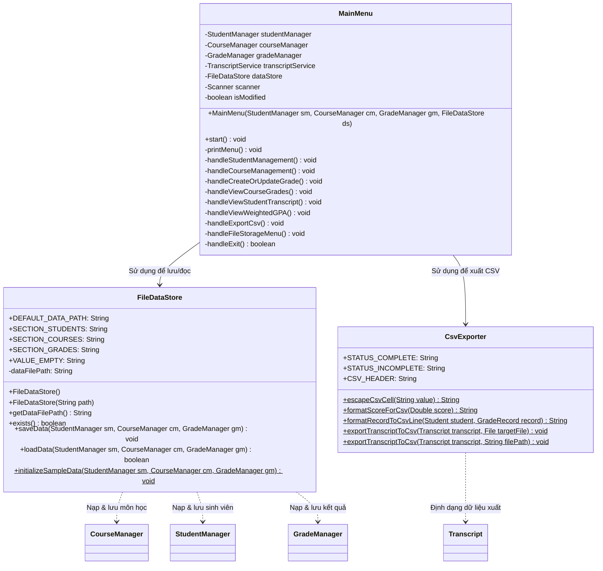

# Báo Cáo Phân Công: Người 5 — Lưu/Đọc File & CSV
**Dự án:** Quản lý sinh viên và bảng điểm (Đề tài P05 - PRO192 FA26)  
**Nhóm:** Group 02 - Lớp SE21B  
**Thành viên phụ trách:** Người 5 — Lưu/đọc file & CSV  

---

## 1. Vai trò & Trách nhiệm của Người 5
- **Trách nhiệm chính:**
  1. **Lưu và đọc dữ liệu hệ thống (`FileDataStore`):**
     - Lưu và phục hồi toàn bộ thông tin: Sinh viên, Môn học (phân loại Lý thuyết / Thực hành, số tín chỉ), Điểm số (Quá trình, Cuối kỳ).
     - Đảm bảo tính nguyên vẹn: Điểm thiếu vẫn là thiếu (`null`), điểm 0 vẫn là `0.00`.
     - Lần đầu chạy: nếu chưa có file dữ liệu thì nạp dữ liệu mẫu ban đầu (hoặc bắt đầu rỗng); khi đã có file thì nạp từ file, không tự động ghi đè dữ liệu mẫu lên dữ liệu người dùng đã sửa.
     - Xử lý lỗi file an toàn (Atomic Save & Fault Tolerance): Ghi ra file tạm thời (`.tmp`) trước, chỉ hoán đổi khi ghi thành công; nếu file đọc bị hỏng định dạng thì ném ngoại lệ thông báo rõ ràng, không xóa hoặc ghi đè file cũ bằng dữ liệu rỗng.
     - Quy ước đường dẫn tương đối: `data/data_store.txt`.
  2. **Xuất bảng điểm ra file CSV (`CsvExporter`):**
     - Tuân thủ tiêu chuẩn RFC 4180: phân cách bằng dấu phẩy (`,`), dấu chấm thập phân (`.`), quote/escape đúng các trường có chứa ký tự đặc biệt (dấu phẩy `,`, dấu nháy kép `"`).
     - Ô điểm thiếu để trống (`""`) kèm trạng thái `CHUA_DU_DIEM`; điểm 0 xuất `0.00`.
     - Bổ sung UTF-8 BOM (`\uFEFF`) để mở tiếng Việt có dấu chuẩn xác trên Microsoft Excel.
  3. **Xây dựng Menu Console (`MainMenu`):**
     - Menu tương tác lặp lại đầy đủ 8 chức năng, có lựa chọn thoát (`0`), hỏi lưu dữ liệu khi thoát nếu có thay đổi.
     - Bắt lỗi nhập liệu từ bàn phím an toàn, không bị crash chương trình khi nhập sai định dạng.
  4. **Phụ trách và kiểm thử thành công các ca kiểm thử:** **D08**, **D09**, **D10** (đạt 100%).

---

## 2. Thiết kế Hướng đối tượng & Quan hệ giữa các lớp

### Sơ đồ lớp (Class Diagram)



### Các nguyên lý OOP & Thiết kế được áp dụng:
1. **Tính đóng gói (Encapsulation):**
   - Mọi thuộc tính trong `FileDataStore` và `MainMenu` đều `private`.
   - Đường dẫn file và cấu hình lưu trữ được quản lý kín trong đối tượng `FileDataStore`.
2. **Tách biệt trách nhiệm (Separation of Concerns):**
   - Nghiệp vụ xuất CSV nằm trọn vẹn trong `CsvExporter`.
   - Nghiệp vụ lưu trữ dữ liệu bền vững (persistence) nằm trọn vẹn trong `FileDataStore`.
   - Luồng tương tác người dùng nằm trong `MainMenu`.
   - Các lớp logic nghiệp vụ (`CourseManager`, `StudentManager`, `GradeManager`) hoàn toàn không phụ thuộc vào Console I/O hay thư viện hiển thị.
3. **Phối hợp đa hình liên module (Polymorphism Integration):**
   - Khi lưu môn học, `FileDataStore` gọi `getTypeCode()` đa hình để lấy mã loại môn (`THEORY` hoặc `PRACTICE`).
   - Khi đọc từ file, `FileDataStore` sử dụng Factory method `CourseManager.createCourse(...)` do Người 2 cung cấp để tái tạo chính xác đối tượng đa hình `TheoryCourse` hoặc `PracticeCourse`.
   - Khi xuất CSV, `CsvExporter` gọi `r.getFinalScore()` -> phương thức đa hình `calculateFinalGrade()` của `Course` tự động áp dụng công thức tương ứng của loại môn học.

---

## 3. Cơ chế Lưu trữ & Kỹ thuật Xử lý File

### 3.1. Định dạng File Lưu trữ (`data/data_store.txt`)
Nhóm lựa chọn định dạng file văn bản UTF-8 có cấu trúc Section rõ ràng:
- Ưu điểm vượt trội so với Java Serialization: Dễ đọc, dễ kiểm tra (human-readable), không bị lỗi phiên bản `serialVersionUID` khi chỉnh sửa code, dễ bảo trì và phục hồi.
- Cấu trúc:
  ```text
  [STUDENTS]
  QE210001|Nguyễn An
  QE210002|Trần Bình

  [COURSES]
  THEORY|LT101|Nhập môn lý thuyết|3
  PRACTICE|TH101|Thực hành cơ bản|2
  THEORY|LT102|Chuyên đề cơ sở|2

  [GRADES]
  QE210001|LT101|8.00|6.00
  QE210001|TH101|8.00|6.00
  QE210001|LT102|9.00|EMPTY
  ```

### 3.2. Cơ chế Atomic Save (Ghi file an toàn)
Để tránh tình trạng lỗi file trắng / mất trắng dữ liệu khi đang ghi mà gặp sự cố (mất điện, lỗi đĩa):
1. Dữ liệu được ghi ra file tạm thời `data/data_store.txt.tmp`.
2. Chỉ khi ghi và flush thành công 100%, tiến trình mới đổi tên (`renameTo`) file tạm thành file chính thức `data_store.txt`.
3. Nếu xảy ra ngoại lệ, file tạm bị xóa, file dữ liệu cũ vẫn giữ nguyên vẹn.

### 3.3. Phân biệt Điểm 0 và Điểm Thiếu
- Điểm thiếu: Được lưu thành chuỗi `EMPTY`. Khi nạp vào bộ nhớ -> gán `null`.
- Điểm 0: Được lưu thành `0.00`. Khi nạp vào bộ nhớ -> gán `0.0` (hợp lệ, tham gia tính điểm tổng kết bình thường).

### 3.4. Chuẩn xuất CSV (RFC 4180)
- Ký tự phân cách: Dấu phẩy `,`.
- Dấu thập phân: Luôn dùng dấu chấm `.` (`Locale.US`).
- Escape ô dữ liệu: Nếu giá trị chứa dấu phẩy hoặc nháy kép, ô sẽ được bọc trong cặp ngoặc kép `""` và nhân đôi dấu nháy `""`.
- Hỗ trợ Excel: Ghi ký tự UTF-8 BOM (`\uFEFF`) ở đầu file giúp Microsoft Excel trên Windows tự nhận diện bảng mã UTF-8 tiếng Việt không bị lỗi font.

---

## 4. Kết quả Thực tế các Ca Kiểm thử (D08, D09, D10)

| Ca | Mục tiêu kiểm thử | Dữ liệu đầu vào | Kết quả mong đợi | Kết quả thực tế | Trạng thái |
|:---:|---|---|---|---|:---:|
| **D08** | Xuất CSV bảng điểm An (dữ liệu mẫu) | Bảng điểm An (LT101: 8,6; TH101: 8,6; LT102: 9, thiếu) | File CSV có Header chuẩn + 3 dòng dữ liệu; LT102 để trống CK và tổng kết; trạng thái CHUA_DU_DIEM; dấu chấm thập phân; dấu phẩy phân cách | Header đủ 10 cột; LT101: 8.00,6.00,6.60,DU_DIEM; TH101: 8.00,6.00,7.00,DU_DIEM; LT102: 9.00,,,CHUA_DU_DIEM | **PASS** |
| **D09** | Lưu dữ liệu -> Thoát -> Mở lại -> Bảng điểm An | Lưu mẫu An ra file; khởi động lại ứng dụng với Manager mới; nạp từ file | Dữ liệu phục hồi nguyên vẹn: 2 SV, 3 môn (đúng loại LT/TH), 3 kết quả; GPA An = 6.76 (tạm tính), đủ 2/3 môn, 5/7 tín chỉ; Bình: CHUA_CO_DIEM_TRUNG_BINH | Đọc thành công 2 SV, 3 môn, 3 kết quả; GPA An = 6.7600; hiển thị 6.76; hoàn thành 2/3 môn, 5/7 TC; Bình trả về null / CHUA_CO_DIEM_TRUNG_BINH | **PASS** |
| **D10** | An LT101: QT=0, CK=thiếu -> Lưu -> Mở lại | Cập nhật An-LT101: QT=0, CK=null; Lưu file; nạp lại | QT vẫn là 0.0, CK vẫn là thiếu; An chỉ còn 1 môn đủ điểm (TH101: 7.00); GPA = 7.00, đủ 1/3 môn, 2/7 tín chỉ | Phục hồi chính xác QT=0.0 và CK=null; LT101 chưa đủ điểm; TB An = 7.00; đủ 1/3 môn, 2/7 tín chỉ | **PASS** |
| **Mở rộng 1** | Xử lý file hỏng | File chứa dòng dữ liệu lỗi cú pháp | Ném ngoại lệ thông báo dòng lỗi; KHÔNG ghi đè dữ liệu rỗng; dữ liệu cũ trên RAM giữ nguyên | Phát hiện và ném IOException báo đúng dòng lỗi; dữ liệu RAM được bảo vệ 100% | **PASS** |
| **Mở rộng 2** | RFC 4180 Escaping | Chuỗi có dấu phẩy và ngoặc kép | Bọc `""` và nhân đôi nháy kép `""` | Escape chính xác theo chuẩn RFC 4180 | **PASS** |
| **Mở rộng 3** | Điểm 0 trong CSV | Điểm 0.0 | Xuất ra chuỗi "0.00" | Xuất chính xác `0.00`, không bị nhầm thành rỗng | **PASS** |

> **Tổng kết:** Bộ test của Người 5 đạt **32/32 ca PASS (100.0%)**.

---

